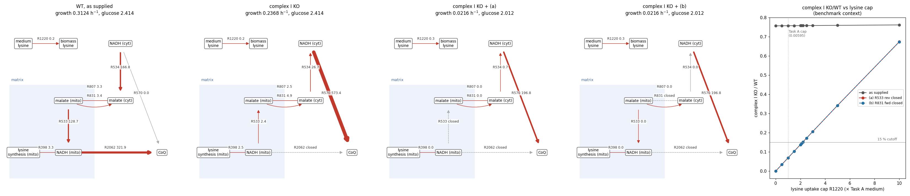

# Benchmark side effects of Task D options (a) and (b), plus homoisocitrate DH location

2026-10-14. Diagnostic only: no model XML, condition, assumption, curation or evidence file was written.
Uncommitted on `claude/task-d-78f16d` @ `8718b75` (Task D commit). Pre-registration: [TASK.md](TASK.md).

Tags: **verified** = run or checked in this session, output linked; **inferred** = reasoned, no run;
**recalled** = from an earlier report, not re-run.

## Summary

1. **(a) and (b) have the same, narrow side effect (verified, [run.json](run.json), [call_changes.csv](call_changes.csv)).**
   In both contexts, each closure changes exactly the 26 complex I (R2062) genes, KO/WT 0.758 → 0.069 in the
   benchmark context. No other gene's ratio moves by more than 1e-6. At 15 %: +14 TP, +5 FP; 7 of the 26 genes
   are mtDNA and out of scope.
2. **Complex I essentiality under (a)/(b) rests on the medium's lysine cap (verified, [lysine_sweep.json](lysine_sweep.json)).**
   With the outlet closed, the KO cannot make lysine and grows only on medium lysine (R1220 at its cap).
   KO growth is linear in that cap (KO/WT near-linear, since WT also rises slightly): 0 without lysine, 0.069 at
   the Task A cap, crossing 0.15 between 2.1× and 2.2× (about 2.17×).
3. **Homoisocitrate DH is most likely mitochondrial in W29.**
   - **Verified (gene structure):** the W29 genome region contains a canonical intron whose unique splice gives
     XP_502662.2. The model's XP_502662.3 starts inside that intron.
   - **Inferred, strongly supported (no transcript evidence):** the XP_502662.3 annotation is wrong.
   - **Prediction-level:** XP_502662.2 has a strong predicted presequence.
   - The model already places R398 in the matrix, so the stoichiometry is unaffected.

## 1. Setup (verified)

| Item | Value |
|---|---|
| Model | `model/candidates/E5_coq9_resp_pkg_r132_20261012.xml` `a56f3649…` (Task B candidate) |
| Medium / profile | `po1f_csm_leu_w29uptake_20261012.csv` `6eca70fd…`; `po1f_sd_leu.json` `35307853…` |
| Experimental list | `consensus_essential_genes.csv` `1e887f5a…`; mtDNA scope `mtdna_genes_out_of_scope.json` `16b3e9b4…` |
| Contexts | `bench` = as loaded (Task B's screen context); `diag` = + Task D holistic overlay + 13C caps (Task D config A) |
| Variants | `base`; `a` = R533 (−1000, 1000) → (0, 1000); `b` = R831 (−1000, 1000) → (−1000, 0) |
| Runner | [run_screen.py](run_screen.py) imports Task B's `run_task_b.py` (`screen()`, `metrics()` unchanged) and Task D's `common.py` (`apply_overlay`, `add_caps`, `close`) and only wraps `context()` |
| Solver | Gurobi, 1 thread, Presolve 0, tolerances 1e-7 (Task B's) |
| LPs | 7,308 (screen) + 66 (lysine sweep); 88 s |

Scoring follows `benchmark.md`: strict KO/WT < cutoff; negatives are model genes not on the consensus list (a
user-defined class); mtDNA genes are out of scope; "no solution" is unresolved. This list was used during model
development, so the scores are a development reference, not independent validation.

**Reproduction checks (all passed, run.json `reproduction_checks`):**
- `bench/base`: 82/33/229/697, 16 unresolved; WT 0.3124267 (Task B).
- `diag/base` complex I KO/WT 0.8264; `diag/a` 0.0767; `diag/b` 0.0767 (Task D 0.826 / 0.077).

## 2. Benchmark (verified)

Benchmark rule (no solution = unresolved). TP / FP / FN / TN, MCC.

| Context / variant | 1 % | 5 % | 10 % | 15 % (primary) | Unresolved |
|---|---|---|---|---|---:|
| bench / base | 64/26/247/704, 0.277 | 70/28/241/702, 0.293 | 74/33/237/697, 0.290 | 82/33/229/697, **0.319** | 16 |
| bench / (a) | same as base | same as base | 88/38/223/692, 0.324 | 96/38/215/692, **0.351** | 16 |
| bench / (b) | identical to (a) | | | | 16 |
| diag / base | 64/26/238/702, 0.284 | 70/28/232/700, 0.300 | 74/33/228/695, 0.298 | 82/33/220/695, **0.327** | 27 |
| diag / (a) | same as base | same as base | 88/38/214/690, 0.332 | 96/38/206/690, **0.360** | 27 |
| diag / (b) | identical to (a) | | | | 27 |

**Genes whose call changes** (NE → E at 10 % and 15 %; unchanged at 1 % and 5 %, because 0.069 > 0.05). The
same 26 genes in all four variant runs, every one with KO/WT 0.7579 → 0.0693 (bench).

| Class | Genes |
|---|---|
| New TP (14) | YALI1A21711g, YALI1B00908g, YALI1B26679g, YALI1C04281g, YALI1D00766g, YALI1D06302g, YALI1D07089g, YALI1D18037g, YALI1D32550g, YALI1E37603g, YALI1F01456g, YALI1F09003g, YALI1F22993g, YALI1F24343g |
| New FP (5) | YALI1B19507g, YALI1D09203g, YALI1D24109g, YALI1E27218g, YALI1F03371g |
| mtDNA, out of scope (7) | YALI1M00056g, YALI1M00064g, YALI1M00296g, YALI1M00335g, YALI1M00338r, YALI1M00458g, YALIfMp29 |

Gene naming (AGENTS.md §4): all are complex I subunits **by model GPR only** (R2062; YALI1D18037g is also on
R78, R1394–R1396 and R2218–R2233, i.e. a multi-reaction gene, likely the mitochondrial ACP). No name or function
was verified this session. The 5 new FP are complex I subunits not on the consensus list. Like the complex III/IV
FPs in Task A, they belong in a later GPR review, not in a judgment of (a) or (b).

## 3. Mechanism and its dependence on lysine (verified; map below)

Benchmark context, one pFBA vector each, per 100 glucose (FVA in run.json):

| | WT | complex I KO | KO + (a) | KO + (b) |
|---|---:|---:|---:|---:|
| growth (h⁻¹) | 0.3124 | 0.2368 | 0.0216 | 0.0216 |
| R398 homoisocitrate DH (matrix NADH) | 3.3 | 2.5 | 0.0 | 0.0 |
| R533 matrix MDH (− = reductive) | +128.7 | −2.4 | closed | 0.0 |
| R831 malate out / citrate in | −3.4 | 4.9 | 0.0 | closed |
| R807 malate out / 2-oxoadipate in | 3.3 | 2.5 | 0.0 | 0.0 |
| R570 NDH2 | 0 | 573 | 197* | 197* |
| R1220 lysine uptake (mmol gDW⁻¹ h⁻¹) | 0.00595 (cap) | 0.00595 | 0.00595 | 0.00595 |

- \* In KO + (a)/(b) the optimum does not fix glucose uptake (FVA R1070 −2.414 to −0.689 mmol gDW⁻¹ h⁻¹;
  R570 0–28.2). The per-100-glucose values in those two columns are one pFBA point, not unique values (audit).
- **Same mechanism as Task D (verified):** without complex I, the matrix NADH from R398 leaves only through
  reductive R533 plus malate export (R831; R807 brings 2-oxoadipate in). FVA for the KO in `bench/base` pins
  R533 to [−0.192, −0.059] and R807 to 0.059 mmol gDW⁻¹ h⁻¹.
- **Closing either step stops lysine synthesis**, and the KO grows only on medium lysine.
  - In the KO + (a) vector, six amino acid uptakes sit at their caps: R1003, R1202, R1204, R1220 (lysine),
    R1231 and R1233. The other six fall below theirs.
  - Being at a cap does not show which one limits growth. The lysine sweep below does: KO growth tracks the
    lysine cap linearly. The other five caps were not swept.

**Lysine-cap sweep** (complex I KO/WT, bench; [lysine_sweep.csv](lysine_sweep.csv)):

| Lysine cap (× 0.00595) | 0 | 0.5 | 1 | 1.5 | 2 | 2.1 | 2.2 | 2.5 | 3 | 5 | 10 |
|---|---|---|---|---|---|---|---|---|---|---|---|
| base | 0.757 | 0.758 | 0.758 | 0.758 | 0.758 | 0.758 | 0.758 | 0.759 | 0.759 | 0.760 | 0.762 |
| (a) | 0.000 | 0.035 | 0.069 | 0.104 | 0.138 | 0.145 | **0.152** | 0.172 | 0.207 | 0.342 | 0.674 |
| (b) | identical to (a) to 3 decimals | | | | | | | | | | |

**Reading (inferred):**
- KO growth is exactly linear in the cap; KO/WT is near-linear because WT rises from 0.3115 to 0.3211 over the
  sweep (audit). The 15 % crossing is at about 2.17×.
- Under (a)/(b), the model's "complex I essential" call is a statement about lysine supply, not about
  respiration.
- On a lysine-free defined medium the KO is lethal (Task D V2 found 0.000, consistent with factor 0 here).
- On the default bound-10 medium the lysine cap is about 4.14× the Task A cap (10 / 2.414 under the same
  scaling rule; not run). By linearity that gives KO/WT ≈ 0.28, i.e. non-essential.
- In vivo, Kerscher 2001 reports complex I deficiency is lethal (**recalled** from Task D §6.3; its growth medium is
  still unread). If that held on lysine-containing medium, the model would need more than (a)/(b) to reproduce
  it. This is untested.



[map_matrix_nadh_outlet.png](map_matrix_nadh_outlet.png) ([make_maps.py](make_maps.py), values in
[map_edges.csv](map_edges.csv)): benchmark context; WT, complex I KO, KO + (a), KO + (b); dashed grey = closed;
edge values per 100 glucose taken up (the edge label shows |flux|; the arrow shows the direction, so in WT the
"R533" arrow runs malate → NADH, i.e. oxidative). Right panel: the lysine sweep.

## 4. Homoisocitrate DH location (R398, YALI1D13238g)

**Model (verified):** homoisocitrate (m624) exists only in the matrix (`C_mi`; R395, R398). There is no
cytosolic homoisocitrate DH.

**Three RefSeq proteins, three N-termini (verified, NCBI efetch; [hidh_isoforms.fasta](hidh_isoforms.fasta)):**

| RefSeq | Strain / locus | N-terminus | Length |
|---|---|---|---:|
| XP_502662.1 | CLIB122, YALI0D10593p | `MYSTGAKTLKIG…` | 365 |
| XP_502662.2 | DSM 3286, YALI2_D00210g | `MFANRAMRLQTR`+`MYSTG…` | 377 |
| XP_502662.3 | CLIB89/W29, YALI1_D13238g (**the model's annotation**) | `MPPQILLDSATEKWFFFF…` | 385 |

NCBI's own note on XP_502662.3 is "Truncated form of YALI0D10593g".

**W29 genome check (verified, [hidh_genome_check.py](hidh_genome_check.py) →
[hidh_genome_check.json](hidh_genome_check.json); region NC_090773.1:1323290–1325646, `47af56fa…`):**
- Exon 1 encodes `MFANRAMRLQTRMYSTGAKTLKI` + the first base of the G codon. It ends `CTCAAGATTG|GTGAGT…`.
- The intron is 165 nt: 5′ `GTGAGT`, branch `TACTAAC` at +154, 3′ `…CCCAG|GT`. These match the usual
  *Y. lipolytica* intron signals (**established / uncited**; no source opened this session).
- The spliced ORF is **identical to XP_502662.2** (377 aa), and its residues 13–377 are identical to XP_502662.1.
- The XP_502662.3 start (`MPPQ…`) lies **inside the intron**. That model reads intron sequence as coding.
- `MFAN` is the first in-frame ATG after the upstream stop.
- **Limit:** no transcript or proteomic data were checked, so the M1 (`MFAN`) vs M13 (`MYST`) start is not
  proven. M1 is the longest ORF.

**Predictors (verified this session; official web servers through the built-in browser; public sequences only;
Task B's rule, fixed in TASK.md: mitochondrial if TargetP mTP ≥ 0.5 or MitoFates ≥ 0.385):**

| Protein | TargetP-2.0 mTP | MitoFates (fungi) | DeepLoc 2.0 mito (signal) | Rule |
|---|---:|---:|---|---|
| XP_502662.2 | **0.9894** (CS 14–15, RMY-ST) | **0.992** (13 MPP, 14 Icp55) | **0.9332** (mitochondrial transit peptide) | mitochondrial |
| XP_502662.1 | 0.0024 | 0.002 | 0.5675 (cytoplasm called) | not |
| XP_502662.3 | 0.0006 | 0.006 | 0.2517 (cytoplasm called) | not |

Job IDs: TargetP `6ACFC7380005D49FCB311564`; MitoFates `20261015.030506.77536` (server clock JST); DeepLoc
`6ACFC7B40005D51BE29B10FE` (Slow/ProtT5, long output), 2026-10-14 ~18:17–18:21 UTC. Full table:
[hidh_predictions.tsv](hidh_predictions.tsv).

**Conclusion:**
- **Inferred:** the matrix placement of R398 is supported by the gene structure plus three predictors.
- *S. cerevisiae* Lys12 is mitochondrial (**recalled** from Task D §6.4, UniProt P40495, high-throughput data).
- This is **prediction-level evidence**, not a localization experiment in *Y. lipolytica*.
- **Separate problem (affects another line):** the model's annotation for YALI1D13238g points to
  XP_502662.3, which the gene structure indicates is mis-spliced (inferred; no transcript evidence). Anything that uses the model's protein sequence (targeting, AlphaFold,
  orthology) should use the spliced protein (= XP_502662.2) instead. Task D's orthology still found Lys12 at 67 %
  identity, because the error only touches the N-terminus.

## 5. What this means for Task D option (a)/(b) (inferred)

- **Side effects:** both are clean. They change only the 26 complex I genes, with identical effect.
- **But neither reproduces complex I essentiality as a respiratory phenotype.** The call holds only while the
  medium's lysine cap stays below 2.2× the Task A value.
- Your step-4 decision (d) stands. Neither result is a reason to write an ASSUMPTION file.
- The open R831 citrate/malate evidence review (worktree `jovial-edison-83497a`) is unaffected by this
  screen, but its outcome would now be known to carry +14 TP / +5 FP and a lysine-dependent complex I call.

## 6. Proven / observed / untested

- **Observed in runs (verified):**
  - the scores and the 26-gene call changes;
  - the reproduction checks;
  - the lysine linearity;
  - the pFBA/FVA route values.
- **Statically verified:**
  - the W29 intron and the identity of the spliced ORF with XP_502662.2;
  - the model's homoisocitrate compartment.
- **Predicted, not experimental:** the HIDH presequence.
- **Untested:**
  - the bound-10 medium (only extrapolated);
  - whether the R807 2-oxoadipate/malate exchange has carrier evidence (YALI1D03221g; Odc1/2-like?);
  - the true translation start of HIDH;
  - Kerscher 2001's medium.

## 7. Deviations and disclosures

- **Not pre-registered:** the lysine sweep and the genome intron check. Both were added after seeing the
  results.
- **[hidh_genome_check.py](hidh_genome_check.py), first run:** it had an off-by-one at the acceptor, and the
  spliced protein frame-shifted after 24 aa. I deleted the JSON it had just written, fixed the index and re-ran.
  The table above is from the fixed run.
- **Literature search for *Y. lipolytica* HIDH localization (TASK.md):** not repeated this session. Task D
  §6.4 found no localization study for YALI0D10593g (**recalled**).
- **Region coordinates:** NCBI Gene esummary gives a 0-based start (1323889). The 1-based gene span is
  1323890–1325047, consistent with the mRNA's offset in `region.fa` (audit defect 10; docstring corrected).
- **After the audit:**
  - `hidh_genome_check.py`: one JSON key renamed (`upstream_peptide_after_last_stop_no_M`) and the docstring
    corrected. I deleted the JSON and re-ran it; the content is unchanged.
  - `make_maps.py`: a label moved inside the axes; the PNG was redrawn.
  - `map_edges.csv` is written in overwrite mode (drawing output, as in Task D).
- **Log location:** the run log went to a sibling folder
  `$IYALI26_RESEARCH_ROOT/artifacts/tasks/complexI_shuttle_assumption_screen_20261014_logs/`, because the runner
  refuses an existing output folder.
- **`diag` context:** 27 unresolved vs 16 in `bench` (verified, per-gene TSVs).
  - 14 genes become unresolved: all are R171 (ATP synthase) genes, KO/WT 1.0 in `bench` and infeasible in
    `diag`. The overlay's R171 GPR drops the OR'd single subunits (prompt header), so these single-gene KOs now
    remove ATP synthase. In this context the R171 KO itself has no solution.
  - 3 of the 14 are mtDNA genes (YALI1M00260g, YALI1M00267g, YALI1M00318g) and are not scored, so the
    scored count rises by 11. No gene moves from unresolved to resolved (audit, verified).
  - Unchanged by (a)/(b).

## 8. Reproduce

From the worktree root, with `IYALI26_RESEARCH_ROOT=/Users/david/Desktop/Lab/Ian wheeldon/code/iyali26_gem_research`
and `PY=<main checkout>/.venv/bin/python`:

```
$PY -B model/reports/complexI_shuttle_assumption_screen_20261014/run_screen.py
$PY -B model/reports/complexI_shuttle_assumption_screen_20261014/lysine_sweep.py
python3 -I model/reports/complexI_shuttle_assumption_screen_20261014/hidh_genome_check.py
python -B model/reports/complexI_shuttle_assumption_screen_20261014/make_maps.py   # conda python with matplotlib
```

The predictors are web jobs and are not re-runnable from a script; the job IDs are above.

## 9. Independent audit (read-only subagent, 2026-10-14, ~110 LPs of its own)

| Claim | Verdict |
|---|---|
| C1 wrapper, closures, diag = Task D config A (0 bound/GPR differences over 2,306 reactions) | SUPPORTED |
| C2 reproduction (Task B and Task D numbers) | SUPPORTED |
| C3 26 genes and all scores, recomputed from the TSVs | SUPPORTED |
| C4 lysine dependence (fresh LPs match; R398 fixed at ~2e-6 by FVA) | SUPPORTED, wording fixed (near-linear ratio, crossing ~2.17×) |
| C5 HIDH gene structure (independent exhaustive GT…AG search: one splice gives XP_502662.2) | SUPPORTED for sequence facts; region.fa not re-fetched; "annotation wrong" relabelled inferred |
| C6 homoisocitrate only in the matrix | SUPPORTED |
| C7 maps match the pFBA vectors | SUPPORTED; non-unique pFBA point noted in §3 |
| Task D `capacity_costs.py` | SUPPORTED (one rounding slip in Task D REPORT) |
| Task D `shuttle_cap.py fine` | mostly SUPPORTED; see Task D defects |

**Fixed here:** defects 1, 6, 7, 8, 9, 10, 11, plus the missing literature-search line.

**Found in Task D's committed files; fixed afterwards with the user's authorization (2026-10-14; see Task D REPORT §7):**
- `shuttle_cap.py:60` labels "no solution" KOs as `essential_15 = True`, against benchmark.md. This affects 24
  floor rows in `shuttle_cap.csv` and `shuttle_cap_fine.csv`.
- REPORT.md lines 40, 454 and 463 overstate the floor-plus-cap essential band:
  - the no-solution boundary is 86.663, the PDH floor;
  - complex I is essential up to about 86.9 (A) or 87.1 (V2), i.e. bands about 0.24 and 0.46 wide, not
    "87.2" or "about 0.5".
- REPORT.md:125 calls R361 "lipoamide DH"; it is the glycine-cleavage complex (lipoamide).
- REPORT.md:132: V2 R315 KO/WT is 0.810, not 0.811.
