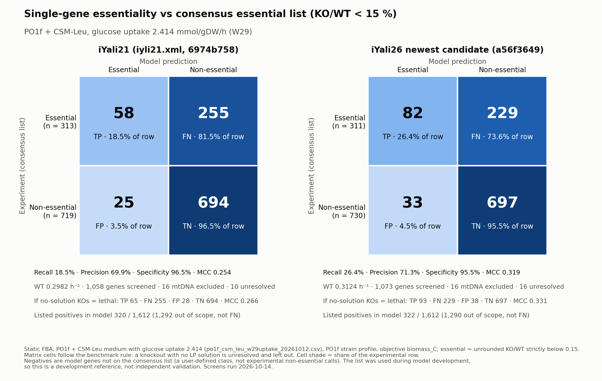

# Confusion matrices: iYali21 and the newest candidate a56f3649, PO1f + CSM-Leu, glucose 2.414 (2026-10-14)

Scope and authorization: [TASK.md](TASK.md). Computation only; no model change, no commit.



[PDF](confusion_matrices_15pct.pdf) · [summary.json](summary.json) ·
[screen_iyali21.manifest.json](screen_iyali21.manifest.json) ·
[screen_a56f3649.manifest.json](screen_a56f3649.manifest.json) ·
[shared_gene_call_differences_15pct.tsv](shared_gene_call_differences_15pct.tsv)

## 1. Setup

| Item | iYali21 | Newest candidate |
| --- | --- | --- |
| Model | `model/source/iyli21.xml` | `model/candidates/E5_coq9_resp_pkg_r132_20261012.xml` |
| SHA-256 | `6974b7588f2a…eda86631` | `a56f3649af21…77b58515` |
| WT growth (h⁻¹) | 0.2982130209 | 0.3124267446 |
| Native genes screened | 1,058 | 1,073 |
| Listed positives in model | 320 / 1,612 | 322 / 1,612 |
| Listed positives out of scope (no model gene; not FN) | 1,292 | 1,290 |
| Knockouts with no LP solution (all `infeasible`) | 11 (10 nuclear + 1 mtDNA) | 20 (16 nuclear + 4 mtDNA) |

- **Shared conditions:**
  - static FBA on `model/conditions/media/po1f_csm_leu_w29uptake_20261012.csv` (`6eca70fd…`):
    PO1f + CSM-Leu, glucose uptake bound 2.414 mmol/gDW/h (the W29 value);
  - PO1f profile (`35307853…`) applied in memory; objective `biomass_C`; NGAM lower bound 7.8625
    in both models;
  - Gurobi 13.0.1, single thread, presolve off, tolerances 1e-7.
- **Classification:** essential if the unrounded KO/WT is strictly below the cutoff.
- **Unresolved:** a knockout with no LP solution is unresolved and left out of the matrix
  (benchmark rule). A second, labelled view counts it as lethal, as Task B did.
- **Labels:**
  - Positives are model genes on the consensus list (`1e887f5a…`).
  - Negatives are model genes not on it. This is the user-defined class, not experimental
    non-essential calls.
  - The 16 mtDNA genes are out of scope.
- **Status:** the list was used during development, so this is a development reference, not
  independent validation.
- **Runs:** 1,059 + 1,074 = 2,133 LPs, exactly the approved budget. They took 9 s and 12 s, with no
  retries and no stop condition hit.

## 2. Results (mtDNA genes out of scope, benchmark rule)

| Model | Cutoff | TP | FN | FP | TN | Unresolved | Recall | Precision | Specificity | MCC |
| --- | ---: | ---: | ---: | ---: | ---: | ---: | ---: | ---: | ---: | ---: |
| iYali21 | 1 % | 40 | 273 | 18 | 701 | 10 | 12.8 % | 69.0 % | 97.5 % | 0.205 |
| iYali21 | 5 % | 47 | 266 | 20 | 699 | 10 | 15.0 % | 70.1 % | 97.2 % | 0.228 |
| iYali21 | 10 % | 51 | 262 | 25 | 694 | 10 | 16.3 % | 67.1 % | 96.5 % | 0.226 |
| **iYali21** | **15 %** | **58** | **255** | **25** | **694** | **10** | **18.5 %** | **69.9 %** | **96.5 %** | **0.254** |
| a56f3649 | 1 % | 64 | 247 | 26 | 704 | 16 | 20.6 % | 71.1 % | 96.4 % | 0.277 |
| a56f3649 | 5 % | 70 | 241 | 28 | 702 | 16 | 22.5 % | 71.4 % | 96.2 % | 0.293 |
| a56f3649 | 10 % | 74 | 237 | 33 | 697 | 16 | 23.8 % | 69.2 % | 95.5 % | 0.291 |
| **a56f3649** | **15 %** | **82** | **229** | **33** | **697** | **16** | **26.4 %** | **71.3 %** | **95.5 %** | **0.319** |

**Labelled second view, "no solution" counted as lethal (15 %):**
- iYali21: 65 / 255 / 28 / 694, MCC 0.266;
- a56f3649: 93 / 229 / 38 / 697, MCC 0.331.

With the 16 mtDNA genes counted as negatives (the pre-2026-10-08 rule), at 15 %:
- iYali21: 58 / 255 / 25 / 709 (11 unresolved);
- a56f3649: 82 / 229 / 33 / 709 (20 unresolved).

All views at all four cutoffs are in [summary.json](summary.json).

## 3. Checks (verified this session)

- **Rescoring:** rescoring every raw row in `summarize.py` reproduces the counts each screen
  recorded, for both scope rules and at all four cutoffs.
- **a56f3649 reproduces Task B.** Compared with Task B's raw table on the same medium
  (`gene_screen_candidate.tsv`, `c9185ecd…`):
  - WT is identical (0.3124267446456666);
  - no solver status changes in 1,073 genes; the largest growth difference over the 1,053 genes
    with a solution is 8.3e-16;
  - no call changes at any cutoff.

  This is "reproduced this time" with a different runner, the same model and the same inputs.
- **iYali21 has no earlier screen on this medium,** so its result is new. It rests on the
  rescoring check and the integrity assertions below. No independent audit was run.
- **Integrity:** inputs and code hashes were unchanged at the end of each run, and the model
  context was restored after every knockout (asserted in `run_screen.py`).

## 4. The unresolved knockouts

Every unresolved knockout belongs to complex III or complex IV in the model GPR. The reaction
assignments below are model GPRs, not experimental validation. Gene names are not verified here.

| Reaction (model) | iYali21 | a56f3649 |
| --- | --- | --- |
| R305: ubiquinol → cytochrome c (complex III by stoichiometry) | 11-gene AND rule; all 11 KOs `infeasible` | the same 11-gene AND rule; all 11 KOs `infeasible` |
| R304: cytochrome c → O₂ (complex IV) | 12-gene AND rule; 11 KOs give KO/WT 0.936, YALI1D11769g is `infeasible` (it is also in R305) | 9-gene AND rule; all 9 KOs `infeasible` |

- **R305** uses ubiquinol-6 in iYali21 but ubiquinol-9 in a56f3649. iYali21 names it
  "ferrocytochrome-c:oxygen oxidoreductase", the same name as R304. The equation is complex III,
  so only the name is off. In a56f3649 it is named "ubiquinol-9:cytochrome-c reductase
  (complex III)".
- **The 11 R305 genes** are YALI1A03322g, YALI1A14736g, YALI1A17570g, YALI1B02487g, YALI1C17100g,
  YALI1D11769g, YALI1E40361g, YALI1F02758g, YALI1F12013g, YALI1F32010g and the mtDNA gene
  YALI1M00390g. Seven of the 10 nuclear genes are listed positives.
- **The 9 R304 genes in a56f3649** are YALI0F04114g, YALI1E12730g, YALI1E15606g, YALI1E19902g,
  YALI1E23635g, YALI1F05089g and the mtDNA genes YALI1M00131g, YALI1M00277g and YALI1M00325g.
  Four of the 6 nuclear genes are listed positives.
- **iYali21's R304 rule** shares 8 of those genes; it lacks YALI1M00131g and adds YALI1D11769g,
  YALI1D23237g, YALI1F04455g and YALI1F06236g.
- **Why no solution (recalled, not re-checked here):** Task A and Task B attributed the infeasible
  complex III and IV knockouts in a56f3649 to an NGAM shortfall. With glucose capped at 2.414, the
  remaining ATP yield cannot cover the fixed NGAM of 7.8625. Under the benchmark rule this is not
  evidence of death, so these genes stay unresolved.
- **iYali21 survives a complex IV knockout (observed):** with R304 closed, iYali21 still grows
  at KO/WT 0.936, while a56f3649 has no solution. Which iYali21 reaction reoxidizes cytochrome c
  instead was not examined.
- YALI1D11769g has a different reaction set in the two models: R1, R2, R3, R303, R304 and R305 in
  iYali21; R304 is absent from it in a56f3649.

## 5. Effect of the medium (SD-Leu → PO1f + CSM-Leu, glucose 2.414)

The SD-Leu matrices for the same two models come from a sibling session's commit `01beb03`. Its
raw tables were compared with these, at 15 %, without new solves (file hashes checked against its
manifests). Its counts were iYali21 61 / 259 / 28 / 694 and a56f3649 90 / 232 / 39 / 696, with 0
unresolved.

| Change at 15 % | iYali21 | a56f3649 |
| --- | ---: | ---: |
| R305 genes: non-essential (KO/WT 0.166 / 0.174) → unresolved | 11 | 11 |
| R304 genes: essential (KO/WT 0.128) → unresolved | 0 | 9 |
| Genes just under the cutoff: essential → non-essential | 6 (0.147 → 0.167) | 8 (0.144 → 0.159) |
| Total call changes | 17 | 28 |

- The near-cutoff group shares one ratio within each model. It is YALI1B22853g, YALI1D08734g,
  YALI1D18130g, YALI1D29419g, YALI1D34865g and YALI1E16002g in both models, plus YALI1D17462g
  (R153) and YALI1F28274g in a56f3649. Their reactions are R93/R560, R909, R607, R96, R152,
  R562/R609, R153 and R1025/R1026/R2202. The shared ratio suggests one common growth-limiting
  effect, but the mechanism was not examined. These calls sit within 0.02 of the 15 % cutoff in
  both media, so they are fragile.

## 6. iYali21 vs a56f3649 on shared genes (this medium)

- **Gene sets:** 1,057 shared genes (1,041 nuclear after the mtDNA exclusion). Only iYali21 has
  `YALIUNK2`; only a56f3649 has 16 genes (listed in summary.json), all predicted non-essential.
- **Calls:** 40 of the 1,041 shared nuclear genes differ at 15 %
  ([shared_gene_call_differences_15pct.tsv](shared_gene_call_differences_15pct.tsv)):
  - 25 listed and 8 unlisted genes are essential only in a56f3649;
  - 4 listed and 2 unlisted genes are non-essential in iYali21 but unresolved in a56f3649 (the
    nuclear R304 genes, §4);
  - 1 listed gene, YALI1C09033g (name not verified; R314/R315), is essential only in iYali21
    (0.032 vs 0.955).
- The individual changes were not reviewed in this task.

## 7. What the matrices mean

- **Recall:** a56f3649 calls more listed genes essential (18.5 % → 26.4 %, 58 → 82 TP).
- **Specificity:** it calls slightly more unlisted genes essential (96.5 % → 95.5 %).
- **Overall:** precision is about 70–71 % in both, and MCC rises from 0.254 to 0.319.
- **Both models still miss most listed positives.** The 229–255 FN are the main gap. Only about
  20 % of the 1,612-gene list has a model gene at all.
- **The medium matters near the cutoff.** On this medium, the respiratory-chain knockouts have no
  solution instead of a ratio, and a group of genes moves from just under to just over 15 %. The
  two models rank the same way as on SD-Leu (MCC 0.251 → 0.318 there).

FP and TN depend on the user-defined negative class. An unlisted gene is not shown to be
non-essential, so precision and specificity measure agreement with list membership, not with
experimental non-essentiality.

## 8. Code logic and possible improvements

- **`run_screen.py`** (unchanged logic from the SD-Leu runner): one WT solve per model, then one
  solve per native gene.
  - Each knockout runs in a COBRA context; `gene.knock_out()` closes the reactions whose GPR
    becomes false.
  - The script records the raw objective, solver status, mass-balance residual and bound
    violation.
  - A solve is scorable only if it is optimal, finite, non-negative and within 1e-6 on both checks.
- **`summarize.py`** re-derives the counts from the raw rows, adds the labelled lethal view,
  checks the a56f3649 rows against Task B and draws the figure. Each cell's shade is its share of
  the experimental row.
- **Possible improvements, with how to test them:**
  - *Separate an ATP shortfall from a true block.* For each unresolved knockout, re-solve with
    the NGAM lower bound at 0. A solution then means the infeasibility is the energy budget, not
    the network. This needs about 20 LPs and a new authorization.
  - *Like-for-like comparison.* Score both models on the 1,041 shared nuclear genes only, then run
    an exact McNemar test on the discordant pairs (33 vs 1 among scorable pairs). No new solves.
  - *Cutoff sensitivity.* 6 iYali21 calls and 8 a56f3649 calls sit within 0.02 of 15 % (the
    group in §5). A KO/WT histogram, or each call's distance to the cutoff, would show which calls
    are fragile.

## 9. Verification levels

| Statement | Level |
| --- | --- |
| Counts, metrics, WT and unresolved lists in §1–2 and §4 | verified: run this session and rescored from raw rows |
| R304/R305 equations, names and GPRs in §4 | verified: read from both SBML files this session (no solves) |
| a56f3649 reproduces Task B on this medium | verified: compared with the Task B raw table this session (hash checked) |
| Medium-effect counts in §5 | verified: compared with the sibling's SD-Leu raw tables this session (hashes checked) |
| NGAM shortfall as the cause of the infeasible complex III/IV knockouts | recalled from Task A/B, not re-checked |
| Which iYali21 route bypasses complex IV | not examined |
| Mechanism of the near-cutoff group | not examined |
| Significance of the iYali21 → a56f3649 difference | untested |

## 10. Limits

- Negatives are a user-defined class.
- The list was used during development, so this is not independent validation.
- `a56f3649` is the newest candidate, not a designated reference model.
- The medium uses the measured W29 glucose uptake, but the screen's experimental list comes from
  PO1f in SD-Leu. The medium differs from the one the list was measured in (the medium file says
  so too).
- No independent read-only audit was run for this task.
- The research root was supplied for this task, because `IYALI26_RESEARCH_ROOT` was unset. All
  inputs match the benchmark hashes.

## 11. Commands (from the repository root)

```
export IYALI26_RESEARCH_ROOT="/Users/david/Desktop/Lab/Ian wheeldon/code/iyali26_gem_research"
PY="/Users/david/Desktop/Lab/Ian wheeldon/code/iyali26_gem/.venv/bin/python"   # cobra 0.30.0, gurobipy 13.0.1
"$PY" -B model/reports/confusion_matrices_csmleu_w29_20261014/run_screen.py --self-check
"$PY" -B model/reports/confusion_matrices_csmleu_w29_20261014/run_screen.py a56f3649
"$PY" -B model/reports/confusion_matrices_csmleu_w29_20261014/run_screen.py iyali21
/opt/miniconda3/bin/python -B model/reports/confusion_matrices_csmleu_w29_20261014/summarize.py   # matplotlib
```

Raw per-knockout tables, solver journals and WT fluxes are in
`$IYALI26_RESEARCH_ROOT/artifacts/tasks/confusion_matrices_csmleu_w29_20261014/`.
