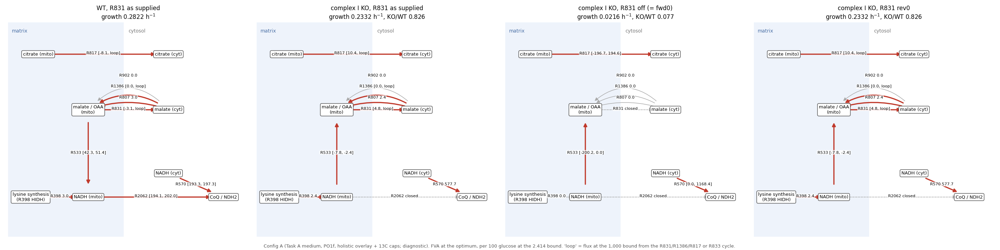

# R831 (Ctp1-type carrier): citrate/malate exchange mode for *Y. lipolytica* (fresh rerun)

2026-10-14. Evidence review plus in-memory diagnostics. No model, condition, assumption or evidence file was
written; nothing committed. Base `claude/task-d-78f16d` @ `c66f3fe`. Pre-registration: [TASK.md](TASK.md).
Tags: **verified** = run or re-read this session; **verified (reviewer)** = a reviewer subagent opened and saved the
text, not re-read by me; **abstract only**; **inferred**; **recalled**.

## Summary

1. **Literature: no direct evidence for a citrate/malate mode of the *Yarrowia* Ctp1 carrier; the
   *S. cerevisiae* data weakly argue against it, and two indirect sources point the other way.**
   - *Y. lipolytica*: YlCtp1p could not be expressed for transport assays (no substrate data). ΔYlctp1 did not
     differ significantly on glucose; on citrate it had a longer lag and lower μ (0.20 vs 0.24 h⁻¹). Citrate export
     is attributed to YlYhm2 (R817) (Yuzbasheva 2019, verified).
   - *S. cerevisiae* Ctp1 (reconstituted, Cys-less): external malate binds weakly, Ki 50.2 mM vs 6.4 mM for
     isocitrate (Aluvila 2010, verified). That internal malate does not support citrate uptake is **inferred**
     (figure insets unread).
   - The citrate/malate antiport at full rate is shown for the **rat/mammalian** CIC (Bisaccia 1990/1993). Reviews
     call yeast Ctp1 a "citrate/malate" carrier by citation.
   - **Pointing the other way (indirect):** in oleaginous yeast, malate was reported as the preferred substrate for
     mitochondrial citrate efflux (Evans 1983c, **second-hand via Yang 2021**). For *Y. lipolytica*, Yuzbasheva 2019
     proposes an α-KG(in)/malate(out) exchange by a not-yet-identified carrier (hypothesis).
   - No yeast carrier has **shown** net malate export from the matrix: Dic1, Odc1/2, Sfc1 and Oac1 move malate in
     physiologically, or do not carry it.
2. **Fit: the W29 13C fit does not depend on R831 (verified).** All 96 fits give identical totals for `asis`, `off`,
   `fwd0` and `rev0`. R1386 + R817 reproduce R831's net citrate-out / malate-in exactly.
3. **Complex I: only the malate-out direction of R831 matters (verified).** `off` = `fwd0` and `rev0` = `asis` in
   all 16 configurations.
   - `off`/`fwd0` makes complex I essential at 10/15 % on the Task A medium (KO/WT 0.069–0.077) and lethal on the
     lysine-free W29 medium (0.000).
   - As in the screen, the Task A call rests on the medium lysine cap: KO growth scales with it. KO/WT crosses 15 %
     at about 2× the cap with overlay + caps (0.153 at 2×), but only between 2× and 5× without them (0.138 at 2×,
     0.342 at 5×).
4. **Benchmark: `off` equals option (b) exactly (verified).** +14 TP, +5 FP, the same 26 complex I genes; MCC
   0.319 → 0.351. `rev0` changes no call.
5. **Orthology: all six carrier genes are reciprocal best hits of their *S. cerevisiae* counterparts (verified).**

**Reading (inferred):**
- Direct evidence does not support R831's citrate/malate mode for *Y. lipolytica*. The indirect oleaginous-yeast
  evidence (second-hand, hypothesis-level) leaves malate export through some carrier open.
- Removing that mode (`off`) costs nothing in WT, in the 13C fit or in the benchmark beyond the complex I genes.
- It is therefore a candidate for a curation change, but this report proposes nothing (§6).

## 1. Literature (A)

Two reviewer subagents saved every text they opened under
`$IYALI26_RESEARCH_ROOT/artifacts/tasks/r831_ctp1_mode_rerun_20261014/evidence/{ctp1,dicarboxylate}/`
(30 files: 17 + 13). Full table: [evidence_table.csv](evidence_table.csv).
- **Evans 1983 was excluded** (TASK.md); where reviews cite it, only the reviewing paper is cited.
- **Unread:** Kaplan 1995 full text (HTTP 403), Kaplan 1990 full text, Kadooka 2019 (server error), Palmieri 2006.
- **DOIs:** several (e.g. Bisaccia 1989/1990/1993, Kaplan 1990/1996, Palmieri 1999/2001) were taken from the
  Europe PMC record the reviewer opened, not from doi.org. That deviates from TASK.md's "every DOI is opened".

**Ctp1 / R831 (YALI1F33754g):**
- **Y. lipolytica (verified, re-read):** Yuzbasheva et al. 2019, Metab Eng 54:264,
  [doi:10.1016/j.ymben.2019.05.002](https://doi.org/10.1016/j.ymben.2019.05.002), full text.
  - "Unlike YlYhm2p, YlCtp1p was not expressed": no substrate data exist.
  - ΔYlctp1 "did not differ significantly" from W29 in growth rate, organic acids and lipids on glucose. On
    citrate medium it had an extended lag and a lower μ (0.20 vs 0.24 h⁻¹).
  - Their model of citrate export runs through YlYhm2 (R817, citrate/2-OG).
  - **Counterpoint (hypothesis):** to complete citrate export they propose an α-KG(in)/malate(out) exchange "by a
    not yet identified mitochondrial carrier" (Fig. 6B legend, re-read). That is the W2 R1386-reverse mode (§4 C3).
    Their YlODC1 deletion did not affect citrate production, so the carrier is unknown.
- **S. cerevisiae (verified, re-read):** Aluvila et al. 2010, J Biol Chem 285:27314,
  [doi:10.1074/jbc.M110.137364](https://doi.org/10.1074/jbc.M110.137364), PMC full text.
  - Cys-less CTP: internal isocitrate supports 18 % of citrate/citrate exchange, and "none of the other eight
    anions" exceed uniport (9 %).
  - That malate is among those eight is **inferred**: the figure insets were not read, and malate is named as a
    tested internal anion for the mutants.
  - Table 3 Ki (external): isocitrate 6.4, PEP 18.6, malate 50.2 ± 6.3 mM.
- **S. cerevisiae, other sources:**
  - Kaplan 1996 (abstract, re-read): ctp1Δ has no phenotype on any carbon source tested.
  - Bakker 2001 (abstract, reviewer): a malate-citrate NADH shuttle is ruled out in *S. cerevisiae*, on the basis
    of missing enzymes/transporters. *S. cerevisiae* lacks ATP-citrate lyase and *Y. lipolytica* has it, so this
    argument does not carry over to *Yarrowia*.
  - Castegna 2010, Assalve 2024 and Primavera 2025 call Ctp1 a citrate/malate carrier by citation of rat CIC,
    Kaplan 1995 and Evans 1983; they add no data (reviewer).
- **Rat CIC (abstract, re-read):** Bisaccia 1990, BBA 1019:250,
  [doi:10.1016/0005-2728(90)90201-e](https://doi.org/10.1016/0005-2728(90)90201-e).
  - Citrate/malate exchange, Km malate 0.76 mM, Vmax independent of the counter-substrate.
  - Physiological direction: citrate out, malate in (Palmieri 2020, reviewer).
- **Mucor CT (reviewer):** fast reconstituted citrate/malate exchange, and malate-driven citrate efflux in
  mitochondria. CT clusters with ODC/SFC and is not a clean Ctp1 ortholog.
  - Yang 2021 also relays Evans 1983c: in oleaginous yeast "malate was the preferred substrate for citrate efflux"
    (re-read; **second-hand**, Evans 1983 itself excluded).

**Other malate carriers** (reviewer table; key passages re-read):
- **Dic1 (R902), verified, re-read:** Palmieri et al. 1999, Mol Microbiol 31:569,
  [doi:10.1046/j.1365-2958.1999.01197.x](https://doi.org/10.1046/j.1365-2958.1999.01197.x), abstract. The primary
  function is to bring dicarboxylates into the matrix "rather than ... exporting malate". In liposomes either
  orientation works (reviewer, abstracts).
- **Odc1/2 (R807, R1386), verified, re-read:** Palmieri et al. 2001, J Biol Chem 276:1916,
  [doi:10.1074/jbc.m004332200](https://doi.org/10.1074/jbc.m004332200), abstract. Strict counter-exchange;
  "to a lesser extent malate"; physiological role 2-oxoadipate/2-OG to the cytosol.
- **Sfc1 (R929), verified, re-read:** Yuzbasheva et al. 2021, Metab Eng,
  [doi:10.1016/j.ymben.2020.11.001](https://doi.org/10.1016/j.ymben.2020.11.001), accepted manuscript. YlSfc1
  malate exchange "lower and not significant".
- **Oac1 (R911), reviewer, abstracts:** OAA uptake and α-isopropylmalate export; malate not listed.
- **Conclusion (reviewer, matching my re-read):** no carrier has **shown** net malate export from the yeast
  matrix. Reverse exchange by Dic1 or Odc is possible in vitro. For *Y. lipolytica*, malate export against α-KG by
  an unidentified carrier is proposed (Yuzbasheva 2019), not shown.

## 2. Orthology (B) (verified, [orthology_summary.json](orthology_summary.json))

Task B's Smith-Waterman over Task C's PF00153 panels (34 *S. cerevisiae*, 38 *Y. lipolytica* CLIB122); queries are
each model gene's own locus protein ([carrier_table.csv](carrier_table.csv)).

| Model gene | Reactions | Forward best (identity) | Reciprocal best hit |
|---|---|---|---|
| YALI1F33754g | R831, R832, R833 | CTP1 (0.672) | yes |
| YALI1B14382g | R817 | YHM2 (0.769) | yes |
| YALI1D03221g | R807, R1386 | ODC1 (0.609; ODC2 reverse 0.596) | yes |
| YALI1B04831g | R902, R928 | DIC1 (0.528) | yes |
| YALI1E41148g | R929 | SFC1 (0.655) | yes |
| YALI1E04823g | R911 | OAC1 (0.619) | yes |

A family-panel test, not proteome-wide. Identity supports the gene assignments; it says nothing about R831's
exchange mode.

## 3. Sequence sources (verified)

Queries were each gene's own locus protein (NCBI esearch by locus tag), `sequences/model_carriers_locus.fasta`.
- Two genes have no RefSeq annotation in the model: YALI1B04831g (ncbigene and UniProt only) and YALI1E04823g (no
  annotation).
- An earlier draft of this section claimed that several model RefSeq annotations named other loci. **That was
  wrong**: a `grep -A25` read ran into the next gene's block (audit defect 1). Parsing each `fbc:geneProduct`
  shows every annotated gene carries only its own RefSeq.
- `sequences/model_carriers_refseq.fasta` was built from that faulty read. Its headers pair some genes with
  neighbouring genes' proteins (e.g. "YALI1F33754g|XP_505457.1" is YALI1_F20788g). It was not used for any result.

## 4. Diagnostics (C) (all DIAGNOSTIC, in memory; 21,892 LPs of the 26,000 cap)

### C1. Elastic fit (verified, [fit_r831_totals.csv](fit_r831_totals.csv), [fit_r831_checks.json](fit_r831_checks.json))

- **Reproduction:** `asis` reproduced Task C's 24 totals (all within relative 1e-6).
- **Result:** for every medium (V2, V1), setup (with or without the R825 ASSUMPTION and the malate-import range)
  and growth fraction, the four variants give **identical** totals. Example: V2 overlay f = 1.0 → 6.516 for all
  four; V2 R825-reversible → 1.433. 17,600 LPs.
- **Why (verified, face spans in [fit_r831_summary.csv](fit_r831_summary.csv)):**
  - With R831 off, R1386 (malate in / 2-OG out) carries 15.4 and R817 (citrate out / 2-OG in) 10.0 per 100
    glucose (V2 overlay). Together they give net citrate out / malate in, which is R831's reverse mode.
  - In `asis`, R831 + R1386 + R817 can also run a net-zero cycle up to the 1,000 flux bound (41,425 per 100
    glucose). R833 (citrate/isocitrate) cycles separately, even with R831 off (±41,400). Both are bounded loops,
    not transport.
- **So:** Task C's malate-import CI is met just as well without R831. The 13C fit gives no reason to keep or remove
  the mode.

### C2. Complex I (verified, [complexI_r831.csv](complexI_r831.csv), [complexI_r831.json](complexI_r831.json); 590 LPs)

- **Reproduction:** 18 checks passed (16 `mechanism.json` robustness ratios for `asis`/`fwd0`, 2 `ratios.json`
  floor rows).
- **WT cost:** every variant costs 0 % WT in every configuration.

| Config | asis | off | fwd0 | rev0 |
|---|---:|---:|---:|---:|
| A, overlay + caps | 0.826 | **0.077** | **0.077** | 0.826 |
| A, overlay only | 0.760 | 0.069 | 0.069 | 0.760 |
| A, caps only | 0.819 | 0.076 | 0.076 | 0.819 |
| A, neither | 0.758 | 0.069 | 0.069 | 0.758 |
| V2, any of the four | 0.753–0.827 | **0.000** | **0.000** | 0.753–0.827 |
| Floors (R825 + PDH + CS + G6PDH), A / V2 | 0.361 / 0.316 | no solution | no solution | 0.361 / 0.316 |

- "No solution" with floors is **unresolved**, not lethal (benchmark.md).
- **FVA, A, overlay + caps (verified):**
  - In the `asis` KO, R831 forward (malate out) is **required**, at 4.82 per 100 glucose minimum.
  - R807 is fixed at 2.41 (2-oxoadipate out / malate in), R398 at 2.41, and R533 reductive at −2.4 to −7.8.
  - In the `off` KO, R398, R807 and R1386 are 0.
  - This is Task D's mechanism: the lysine-pathway NADH leaves the matrix as malate only through R831.
- **Lysine (verified; [lysine_detail.csv](lysine_detail.csv), added after the run):**
  - In every `off`/`fwd0` KO below 15 % on the A medium, R1220 is pinned at its cap (FVA).
  - KO growth with overlay + caps: 0.0216 at the cap, 0.0433 at 2×, 0.108 at 5×. KO/WT is 0.077, 0.153 and 0.377.
  - At uptake 1000, lysine becomes a carbon source and WT grows at 9.8 h⁻¹. The pre-registered "lysine opened"
    ratio (0.02) is therefore not interpretable (§7).

### C3. What-if carriers (verified, WHAT-IF, not a proposal)

With R831 off, overlay + caps:

| | A WT | A KO/WT | V2 WT | V2 KO/WT |
|---|---:|---:|---:|---:|
| R831 off, nothing opened | 0.2822 | 0.077 | 0.2627 | 0.000 |
| W1 R902 reverse (malate out / Pi in) | **0.2929** | 0.905 | **0.2748** | 0.903 |
| W2 R1386 reverse (malate out / 2-OG in) | 0.2822 | 0.826 | 0.2627 | 0.827 |
| W3 both | 0.2929 | 0.905 | 0.2748 | 0.903 |

- **W1 raises WT** by 3.8 % (A) and 4.6 % (V2), and its KO/WT uses that raised WT.
- Either carrier's export mode would undo the essentiality.
- Literature: neither has a shown physiological export role (§1). W2's mode (α-KG in / malate out) is the one
  Yuzbasheva 2019 hypothesise for an unidentified *Y. lipolytica* carrier.

### C4. Gene benchmark (verified, [screen_r831.json](screen_r831.json), [screen_r831_changes.csv](screen_r831_changes.csv); 3,654 LPs)

- **Context:** benchmark context (Task B candidate, Task A medium, PO1f; no overlay). The base reproduced
  82/33/229/697/16.
- **Scoring:** negatives are model genes not on the consensus list (user-defined class); mtDNA genes are out of
  scope; development reference, not independent validation.

| Variant | 1 % | 5 % | 10 % | 15 % (primary) | MCC 15 % |
|---|---|---|---|---|---:|
| base | 64/26/247/704 | 70/28/241/702 | 74/33/237/697 | 82/33/229/697 | 0.319 |
| off | same | same | 88/38/223/692 | **96/38/215/692** | **0.351** |
| fwd0 (= screen option b, `c66f3fe`) | same | same | 88/38/223/692 | 96/38/215/692 | 0.351 |
| rev0 | same | same | same | 82/33/229/697 | 0.319 |

- **Calls:** `off` changes exactly the 26 complex I genes of option (b): 14 TP, 5 FP, 7 mtDNA (gene list in the
  screen report).
- **Ratios:** `off` and `rev0` also move YALI1B14382g (Yhm2, R817) from 1.000 to 0.998, with no call change.

## 5. Map



[map_r831_matrix_malate.png](map_r831_matrix_malate.png) ([make_maps.py](make_maps.py),
[map_edges.csv](map_edges.csv)):
- Config A, FVA ranges at the optimum; panels WT `asis`, KO `asis`, KO `off` (= `fwd0`), KO `rev0`.
- In the `asis` KO the lysine-pathway NADH (R398) goes to malate (R533 reductive) and leaves via R831. With R831
  off, that whole branch is 0.
- "loop" marks fluxes at the 1,000 bound from the bounded R831/R1386/R817 cycle or the separate R833 cycle.

## 6. What this means (inferred; no proposal is made here)

- **Evidence vs. model:**
  - R831's citrate/malate mode has no direct *Yarrowia* support. It is not supported by, and weakly argued
    against by, the *S. cerevisiae* data (Ki is affinity, not absence of transport; the internal-malate null is
    inferred).
  - Indirect evidence points the other way: second-hand oleaginous-yeast data and a *Yarrowia* hypothesis of malate
    export by an unidentified carrier. Which carrier, if any, exports malate in *Y. lipolytica* is open.
  - R832 (citrate/PEP) and R833 (citrate/isocitrate) match the yeast Ctp1 substrates better. The model keeps all
    three as reversible, unconstrained exchanges.
- **Cost of removing R831 (`off`):**
  - none for WT, the 13C fit or non-complex-I genes;
  - it brings the model's complex I call into line with Kerscher 2001 (**recalled**) on the W29 medium (lethal);
  - on the CSM-Leu-type Task A medium it is essential only while the lysine cap stays low: below ~2× with overlay +
    caps, below some value between 2× and 5× without (0.342 at 5×).
- **Required by AGENTS.md before any change:**
  - Removing a reaction or a direction needs evidence of absence. "YlCtp1p untested, Sc Ctp1 malate-poor" is
    absence of support, not proof of absence.
  - A curation change would need its own authorized `curation-change` run: guarded data file, new candidate,
    whole-model diff and audit. Bounds-only alternatives would go in an ASSUMPTION condition file.
  - The +14 TP / +5 FP benchmark gain must not be the reason; it is a side effect.
- **Loops:** the R831 + R1386 + R817 cycle and the separate R833 cycle exist in the as-supplied model regardless
  of this question.
  It is worth flagging for loop-law checks (affects another line).

## 7. Deviations and disclosures

- **Lysine check:** the pre-registered "KO/WT with lysine opened to 1000" turned lysine into a carbon source (WT
  9.8 h⁻¹), so that ratio is not meaningful. I added [lysine_detail.py](lysine_detail.py) (48 LPs, not
  pre-registered) with absolute growth at 1×, 2× and 5× the cap and at 1000.
- **Queries:** step B used each gene's own locus protein, because two genes have no model RefSeq (§3).
- **Withdrawn finding:** a draft claimed that model RefSeq annotations name other loci. It came from a faulty grep
  read and is withdrawn (§3, audit defect 1).
  - `orthology_sw.py`'s docstring and `carrier_table.csv` were corrected after the run. The script's SHA therefore
    changed; its code did not.
  - `model_carriers_refseq.fasta` has mislabelled headers and is unused.
- **Map:**
  - First draw: R570 = 1,168 was wrongly labelled "loop" and its source node mislabelled. I fixed the threshold and
    label and redrew.
  - Because a failed edit was chained to a deletion, `map_edges.csv` was briefly regenerated by the old script,
    then deleted and regenerated by the fixed one. Drawing outputs only.
- **Cross-check against the earlier attempt (not used as evidence):** its fit totals (96) and complex I grid (32)
  match this run exactly.
- **Earlier attempt's evidence folder:** it holds Evans 1983 full texts, which the user did not supply; they were
  not opened here.
- **Side finding (Task D, committed, not changed):** `complexI_transhydrogenation_20261012/ratios.py` labels
  no-solution KOs `complex_I_essential_15 = True`. This is the same defect fixed in `shuttle_cap.py` in `651049a`.
- **Reviewer process:** the two reviewers shared a scratch helper (`save.py`), and one overwrote the other's. The
  dicarboxylate reviewer checked that none of its files landed in `ctp1/`.
- **Lysine-check scope:** C2's lysine check covers config A only, as pre-registered.

## 8. Reproduce

From the worktree root with `IYALI26_RESEARCH_ROOT=/Users/david/Desktop/Lab/Ian wheeldon/code/iyali26_gem_research`
and `PY=<main checkout>/.venv/bin/python`:

```
$PY -B model/reports/r831_ctp1_mode_rerun_20261014/fit_r831.py
$PY -B model/reports/r831_ctp1_mode_rerun_20261014/complexI_r831.py
$PY -B model/reports/r831_ctp1_mode_rerun_20261014/lysine_detail.py
$PY -B model/reports/r831_ctp1_mode_rerun_20261014/screen_r831.py
$PY -B model/reports/r831_ctp1_mode_rerun_20261014/orthology_sw.py
python -B model/reports/r831_ctp1_mode_rerun_20261014/make_maps.py
```

Sequences were fetched with NCBI efetch/esearch (commands in the session log); the files and their SHAs are in
`sequences/`: `model_carriers_refseq.fasta` `ee054161…`, `model_carriers_locus.fasta` `da57bb6b…`.

## 9. Independent audit (read-only subagent, 2026-10-14; ~21 fresh LPs of its own)

| Check | Verdict |
|---|---|
| Helpers unchanged (12 SHA pins), variants applied correctly, no state leaks | SUPPORTED |
| Reproduction (24 fit, 18 complex I, screen base) | SUPPORTED |
| 96 fit totals identical; R1386 + R817 substitute (fresh: off − R1386 → 8.164, off − R817 → 7.331) | SUPPORTED |
| Complex I, FVA, floors, what-if, lysine numbers (fresh LPs match) | numbers SUPPORTED; wording fixed (lysine threshold by configuration, what-if WT rise) |
| C4 screen recomputed; `off` = option (b) gene set | SUPPORTED |
| Orthology | SUPPORTED |
| §3 annotation finding | **NOT SUPPORTED: withdrawn** (faulty grep) |
| Literature quotes, DOIs, no Evans 1983 source | quotes SUPPORTED; omissions and overclaims fixed (Yang 2021 / Yuzbasheva 2019 counterpoints, Bakker caveat, Δctp1 citrate phenotype, "contradicted" softened, Aluvila internal-malate labelled inferred) |
| Map/edges | SUPPORTED; loop wording fixed |
| Deviations and LP total (21,892 ≤ 26,000) | SUPPORTED after added disclosures |

All 10 defects were addressed in the text and tables. No numbers needed re-running. The fixes were not re-audited.
- The V2 `off`/`fwd0` KO FVA was skipped because growth is 0. The script only runs FVA when growth > 0.
