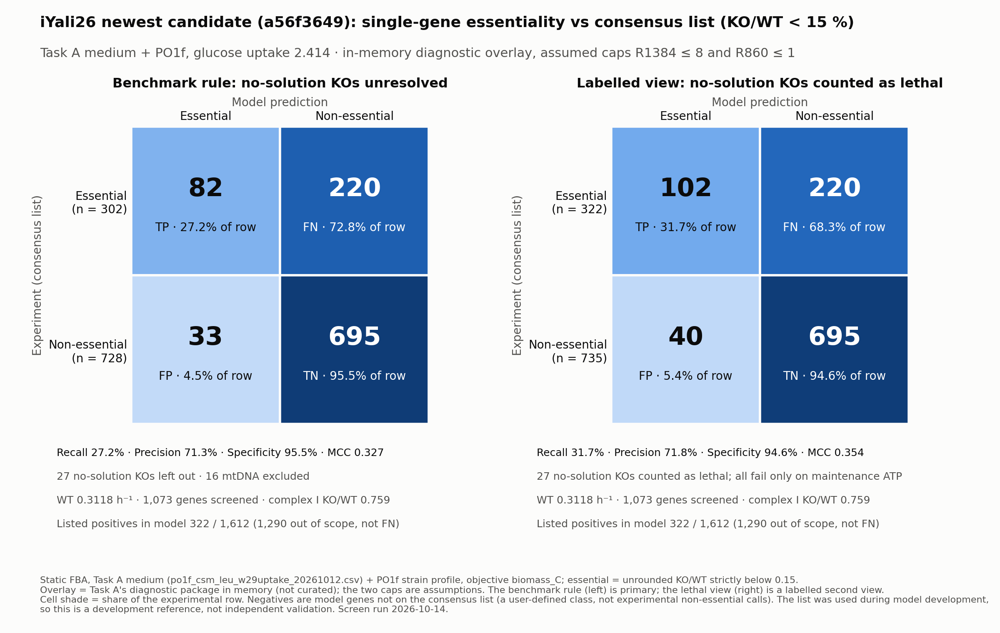

# a56f3649 under Task A's diagnostic overlay, Task A medium + PO1f, glucose 2.414 (2026-10-14)

Scope and authorization: [TASK.md](TASK.md). Computation only; the overlay exists in memory only. No
model change, no commit.



[PDF](confusion_matrices_15pct.pdf) · [summary.json](summary.json) ·
[screen.manifest.json](screen.manifest.json)

## 1. Setup

| Item | Value |
| --- | --- |
| Model | `model/candidates/E5_coq9_resp_pkg_r132_20261012.xml`, `a56f3649af21…77b58515` (newest candidate; not a reference) |
| Medium | `po1f_csm_leu_w29uptake_20261012.csv` (`6eca70fd…`): Task A medium (CSM-Leu recipe), glucose uptake bound 2.414 |
| Strain profile | PO1f, `35307853…`, in memory |
| Overlay | `reports/r132_mito_adh_20261012/holistic_overlay.py` (`bf6c7ce5…`), a verbatim copy of Task A's `apply_overlay`, in memory only |
| Assumed caps | **R1384 ≤ 8** (proton leak) and **R860 ≤ 1** (Ggc1 GTP/GDP carrier), ASSUMPTION (diagnostic) |
| Experimental list | `consensus_essential_genes.csv` (`1e887f5a…`) |
| Solver | Gurobi 13.0.1, 1 thread, presolve off, tolerances 1e-7; objective `biomass_C`; NGAM lower bound 7.8625 |
| LPs | 1,189 of the approved 1,228: WT, 4 controls and 1,073 gene KOs (1,078), plus the NGAM diagnostic (111) |
| Time | 15 s, no retries, no stop condition hit |

**What the overlay does** (same as Task A):
- R1864/R1866 rewritten from 2 NAD(H) to 1;
- R2069 rewritten to KEGG R01752;
- R1882, R1883, R1884, R2255, R2259, R2263, R_MDHy and R_ALCDH_nadp_hi closed;
- ethanol export R1113 closed;
- the R171 (ATP synthase) GPR reduced to its 14-gene AND core, which drops the two OR'd genes
  YALI1B28025g and YALI1B15733g;
- the two caps above.

It does not reference R132, which a56f3649 no longer has. Every structural assertion in the overlay
passed. After the overlay, the only forced bound is still `xMAINTENANCE` ≥ 7.8625.

## 2. Results (mtDNA genes out of scope)

| View | Cutoff | TP | FN | FP | TN | Unresolved | Recall | Precision | Specificity | MCC |
| --- | ---: | ---: | ---: | ---: | ---: | ---: | ---: | ---: | ---: | ---: |
| Benchmark rule | 1 % | 64 | 238 | 26 | 702 | 27 | 21.2 % | 71.1 % | 96.4 % | 0.284 |
| Benchmark rule | 5 % | 70 | 232 | 28 | 700 | 27 | 23.2 % | 71.4 % | 96.2 % | 0.300 |
| Benchmark rule | 10 % | 74 | 228 | 33 | 695 | 27 | 24.5 % | 69.2 % | 95.5 % | 0.298 |
| **Benchmark rule (primary)** | **15 %** | **82** | **220** | **33** | **695** | **27** | **27.2 %** | **71.3 %** | **95.5 %** | **0.327** |
| Lethal view | 1 % | 84 | 238 | 33 | 702 | 0 | 26.1 % | 71.8 % | 95.5 % | 0.317 |
| Lethal view | 5 % | 90 | 232 | 35 | 700 | 0 | 28.0 % | 72.0 % | 95.2 % | 0.331 |
| Lethal view | 10 % | 94 | 228 | 40 | 695 | 0 | 29.2 % | 70.1 % | 94.6 % | 0.329 |
| **Lethal view (labelled)** | **15 %** | **102** | **220** | **40** | **695** | **0** | **31.7 %** | **71.8 %** | **94.6 %** | **0.354** |

- **Lethal view:** every knockout with no solution is counted as lethal. This is the labelled second
  view the user chose for Task A on 2026-10-13. It is not the benchmark rule.
- **Maintenance view:** Task A's §5 proposal, not adopted, counts only the "cannot meet
  maintenance" knockouts as lethal. It is identical to the lethal view here, because all 27 meet
  that test (§3).
- **Controls:**
  - WT 0.3117523151.
  - Complex I (R2062) KO/WT 0.759.
  - Complex III (R305), complex IV (R304) and ATP synthase (R171): no solution.
- Positives: 322 of the 1,612 listed genes are model genes; 1,290 are out of scope (not FN).

## 3. The 27 knockouts with no solution

There are 34 genes with no solution, 7 of them mtDNA (out of scope). The reaction assignments are model
GPRs, not experimental validation. Gene names and identities are in Task A's REPORT §6.

| Reaction (model) | Genes in scope | Listed | Unlisted | mtDNA (not scored) | Max maintenance ATP (mmol gDW⁻¹ h⁻¹) |
| --- | ---: | ---: | ---: | ---: | ---: |
| R305, complex III | 10 | 7 | 3 | 1 | 2.0766 |
| R304, complex IV | 6 | 4 | 2 | 3 | 2.0766 |
| R171, ATP synthase (AND core after the overlay) | 11 | 9 | 2 | 3 | 3.3623 |
| **Total** | **27** | **20** | **7** | **7** | |

- **NGAM diagnostic** (37 knockouts: 34 genes and 3 reaction controls):
  - every one is re-confirmed infeasible with the NGAM floor;
  - every one is feasible with only that floor removed;
  - every one has a maximum maintenance ATP below 7.8625.

  All 37 are therefore "cannot meet maintenance"; none is "other cause". Because the only forced
  bound is NGAM (§1), that is the only way a knockout can have no solution here.
- With the NGAM floor removed, the reaction KOs would grow at 0.045 (R305), 0.035 (R304) and 0.071
  (R171). These values are not scored.
- The lethal view's gain of 20 TP and 7 FP is exactly these 27 genes.
- **The ATP synthase calls depend on the assumed caps (recalled from Task A, not re-checked):**
  - Two overlay parts are needed. The AND-core GPR makes a single gene knockout close R171. The two
    ASSUMPTION caps then limit the maximum maintenance ATP: for the parent, Task A found both caps
    binding in the R171 KO (R1384 = 8.00, R860 = 1.00). What an R171 KO gives under the overlay
    without the caps was not checked.
  - Without the overlay, the reaction KO of R171 gives KO/WT 0.110 on this medium (Task B), which
    has a solution. A single R171 gene knockout gives KO/WT 1.0 there, because the two OR'd genes
    keep R171 open (verified from this session's no-overlay raw table).

## 4. Comparison with the parent `0ac2addf` under the same overlay (Task A, no new solves)

Compared gene by gene with Task A's raw overlay table (`gene_screen_holistic_overlay_diagnostic.tsv`,
`e9f4ca6f…`) and its NGAM table (`ngam_diagnostic.tsv`, `2d2a245d…`). Both files are uncommitted in
worktree `competent-turing-bc6e9b`; their hashes match Task A's run records.

- **WT is the same:** 0.3117523151 in both (difference 5.6e-17).
- **No solver status changes,** and **no call changes at 1, 5, 10 or 15 %**. Every count above
  equals Task A's overlay row: 82 / 220 / 33 / 695 with 27 unresolved, and 102 / 40 / 220 / 695 in
  the lethal view.
- **28 ratios change by more than 1e-6,** none across a cutoff:
  - 26 complex I genes: 0.856 → 0.759;
  - YALI1D34529g (unlisted; R822/R823/R875; name not verified): 0.994 → 0.951;
  - YALI1E17214g (unlisted; R533/R534/R535/R_MDHy; name not verified): 0.997 → 0.942.

  These are the same 28 genes whose ratio changed without the overlay in Task B, when R132 was
  removed.
- **NGAM diagnostic:** the same 37 knockouts and labels. Maximum maintenance ATP is unchanged for
  complex III/IV (2.0766). For ATP synthase it falls slightly, from 3.3642 to 3.3623.
- **Meaning:** under the overlay, removing R132 changes no essentiality call. It lowers the
  complex I KO/WT, as it did without the overlay (Task B: 0.854 → 0.758).

## 5. What it means

- On this medium and overlay, the newest candidate scores exactly what the parent scored. Recall
  is 27.2 % (benchmark rule) or 31.7 % (lethal view), precision about 71 % and MCC 0.327 / 0.354.
- **Overlay vs no overlay** (a56f3649, same medium, 15 %; the no-overlay numbers are from this
  session's confusion-matrix screen):

  | | Benchmark rule | Lethal view |
  | --- | --- | --- |
  | No overlay | 82 / 229 / 33 / 697, 16 unresolved, MCC 0.319 | 93 / 229 / 38 / 697, MCC 0.331 |
  | Overlay | 82 / 220 / 33 / 695, 27 unresolved, MCC 0.327 | 102 / 220 / 40 / 695, MCC 0.354 |

  - Exactly 14 calls change at 15 %, all R171 genes (verified gene by gene against the no-overlay
    raw table). Without the overlay each one is non-essential (KO/WT 1.0, the OR'd genes keep R171
    open). With the overlay each one has no solution.
  - Under the benchmark rule, that moves 9 nuclear positives out of FN and 2 nuclear negatives out
    of TN into unresolved; the other 3 are mtDNA genes.
  - The lethal view then counts the 11 as essential, which adds 9 TP and 2 FP over the no-overlay
    lethal view.
  - The gain in the lethal view therefore comes from removing the OR'd genes from R171 and from
    the two assumed caps (§3).
- FP and TN depend on the user-defined negative class. Precision and specificity measure agreement
  with list membership, not with experimental non-essentiality.

## 6. Code logic and possible improvements

- **`run_screen.py`:** the confusion-matrix runner with three additions:
  - the overlay, hash-checked, applied after the effective context is built;
  - four reaction controls;
  - Task A's three-step NGAM diagnostic: re-confirm, relax only the NGAM floor, then maximize
    `xMAINTENANCE`.

  It asserts that NGAM is the only forced bound, restores the model after every knockout and checks
  every input and code hash at the end.
- **`summarize.py`:**
  - re-derives the benchmark counts from the raw rows (asserted equal to the run's own);
  - adds the lethal and maintenance views;
  - compares every gene and every diagnostic row with Task A;
  - draws the figure.
- **Possible improvements, with how to test them:**
  - *Cap sensitivity for the ATP synthase calls.* Re-run the R171 KO and WT at a grid of R1384 and
    R860 caps, about 20–40 LPs. That would show the cap value at which the 11 R171 genes stop
    having no solution. The user's "below ~61" statement in Task A could be checked the same way.
  - *Adopting Task A's §5 rule* (score "cannot meet maintenance" as essential) would make the
    lethal view the benchmark here. That needs the user's decision and a dated `benchmark.md` edit.

## 7. Verification levels

| Statement | Level |
| --- | --- |
| Counts, metrics, controls, WT and the unresolved list (§2–3) | verified: run this session, rescored from raw rows |
| All 37 no-solution knockouts "cannot meet maintenance" | verified: diagnostic run this session |
| Identity with Task A's calls and labels (§4) | verified: compared with Task A's raw tables this session (hashes checked) |
| Overlay vs no overlay: 14 call changes, all R171 genes (§5) | verified: compared with this session's no-overlay raw table (no solves) |
| ATP synthase lethality depends on both caps binding | recalled from Task A (parent model); not re-checked for a56f3649 |
| Overlay chemistry caveat (+1 H, +1 charge in R1864/R1866; m1949 has no formula) | recalled from Task A's audit F3 |

## 8. Limits

- The overlay is a diagnostic package, not curated; its two caps are assumptions. Results under it
  are diagnostic only.
- Negatives are a user-defined class.
- The list was used during development, so this is not independent validation.
- `a56f3649` is the newest candidate, not a designated reference model.
- No independent read-only audit was run for this task.

## 9. Commands (from the repository root)

```
export IYALI26_RESEARCH_ROOT="/Users/david/Desktop/Lab/Ian wheeldon/code/iyali26_gem_research"
PY="/Users/david/Desktop/Lab/Ian wheeldon/code/iyali26_gem/.venv/bin/python"   # cobra 0.30.0, gurobipy 13.0.1
"$PY" -B model/reports/screen_a56f3649_overlay_w29_20261014/run_screen.py --self-check
"$PY" -B model/reports/screen_a56f3649_overlay_w29_20261014/run_screen.py run
/opt/miniconda3/bin/python -B model/reports/screen_a56f3649_overlay_w29_20261014/summarize.py   # matplotlib
```

Raw per-knockout table, NGAM diagnostic table, solver journal and WT fluxes are in
`$IYALI26_RESEARCH_ROOT/artifacts/tasks/screen_a56f3649_overlay_w29_20261014/`.
